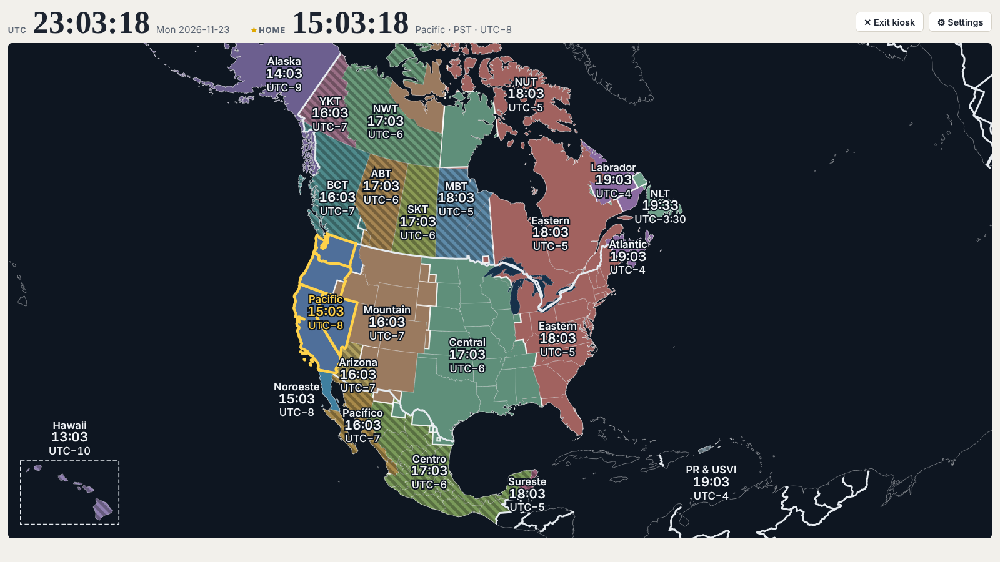

# North American Time Zones — standalone edition

A live time zone map and clock for Canada, the United States (including Alaska, Hawaii, Puerto Rico and the US Virgin Islands) and Mexico. It's one HTML file that runs offline in any browser, on Windows, macOS, Linux or a Raspberry Pi.

**This is a fork.** The original map is by **Vince d'Eon, VE6LK**:

- Vince's repository: https://github.com/vincedeon/NorthAmericanTimeZones
- Vince's live map: https://vincedeon.github.io/NorthAmericanTimeZones/time-zones-local.html

The standalone edition (v1.7) has been merged into Vince's repository. This fork carries v1.8, which adds map views and a Fill setting on top of that.

## Using it

Download `time-zones-local.html` and double-click it. That's all: the map data and libraries are built into the file, so it needs no internet connection and no web server. Copy it to any machine.

- Press **S** (or click **Settings**) to change things. Settings are saved in that browser.
- Press **K** for kiosk mode, which fills the window with the map and hides the mouse pointer. **F** toggles full screen, and **Esc** exits.

## What it does

- **UTC clock** across the top, with seconds and the UTC date, and a **home** clock beside it
- **Home zone** auto-detected from the computer (or chosen in Settings), outlined in gold on the map
- **Kiosk mode** for a shack display
- **12-hour or 24-hour** time
- **Mexico**, with all 32 states in four zones, plus the US-border areas that follow US daylight time
- **+1 day / −1 day** markers wherever the date differs from home
- **Map shows** (new in v1.8): all three countries, any two, one country, or the US lower 48
- **Map fit** (new in v1.8): "Fill the screen" zooms the map to fill the window, so the labels get bigger on screens that don't match the map's shape. No time zone label is ever cut off.
- **Map edges** (new in v1.8): optionally trims the far north and western Alaska for a bigger map
- **Older browsers:** if a browser doesn't recognise one of the newer time zone names (Chromium 92 on Debian 12 doesn't know Ciudad Juárez, for example), that one clock shows a dash, every other clock keeps running, and a short note under the map names the zone
- **URL options** for dedicated displays, such as `time-zones-local.html?kiosk=1&view=caus&fit=1`. See `source/README.md` for the full list.

## Credits and licence

Original map and time rules by Vince d'Eon, VE6LK. Standalone edition by Tom Salzer, KJ7T. Both are CC0 (public domain): use and modify them to suit your needs.

Coded with Anthropic's Claude.

The bundled libraries and map data have their own licences (ISC and public domain); see `source/LICENSES.txt`. The editable source and the build script are in the `source` folder.

73 de VE6LK and KJ7T
